# RIR-RAR

API REST para procesamiento y analisis de respuestas al impulso segun la norma ISO 3382.

<!-- Badge de CI: reemplazar <usuario>/<repo> por los datos del repositorio del grupo -->


## Descripción

En este trabajo práctrico de Señales y Sistemas de la carrera de Ingeniería de sonido en UNTREF se desarollará una API REST diseñada para el procesamiento y 
análisis de respuestas al impulso en recintos (RIR). 
Esta herramienta permite recibir archivos de audio con señales acústicas y procesarlas 
para calcular parámetros definidos por la norma ISO 3382-1, tales como el tiempo de reverberación (T20, T30), el tiempo de 
decaimiento temprano (EDT), indice de claridad (C80) y el indice de definición (D50).
El objetivo principal es brindar una interfaz de programación que automatice la cadena completa de análisis y procesamiento acústico: 
desde la limpieza y filtrado de la señal de excitación, hasta la obtención de datos para la evaluación y analisis de la actividad sonora de salas.


- Consigna, especificaciones y ruta del TP: <https://maxiyommi.github.io/signal-systems/trabajo_practico/ruta/>
- API de referencia de la catedra (Swagger UI): <https://rir-api.onrender.com/docs>

## Integrantes

| Nombre | Legajo | Rol | Rol por área del TP |
|--------|--------|-----|---------------------|
|Cadirola Valentino|80692|Dev|Servicios, Routers y Schemas para M1, implementación principal de M2, generación de documentación para M1 y M2, Routers, Schemas y documentación para M3
|Collado Horlent Vicente|80478|Reviewer / QA|Servicios M1, corrección de fallas en milestones previos, Review y Merge de Pull Request, Servicios para M3
|Pascuccelli Tadeo|72794|Colaborador| Servicio play_and_record (M1)

## Requisitos previos

- Python 3.12 o superior
- [uv](https://docs.astral.sh/uv/) (gestor de paquetes y entornos virtuales)
- git y una cuenta de GitHub

## Instalacion y ejecucion

```bash
# Crear el entorno e instalar dependencias (incluye las de desarrollo: pytest, ruff, ...)
git clone https://github.com/Cadirola24/rir-rar
cd rir-rar
uv sync

# Iniciar la API con hot-reload
uv run uvicorn app.main:app --reload

# Correr los tests
uv run pytest
```

La API queda disponible en `http://localhost:8000`. Documentacion interactiva:

- Swagger UI: `http://localhost:8000/docs`
- ReDoc: `http://localhost:8000/redoc`

`uv sync` genera un `uv.lock` con las versiones exactas instaladas: **commitéenlo** en el
repositorio del grupo para que todos (y el CI) usen las mismas versiones.

## Uso de la API

Servidor corriendo con `uv run uvicorn app.main:app --reload` antes de ejecutar los comandos en la terminal.

### M1: Generación de Señales

#### Generar Ruido Rosa
Genera una señal de ruido rosa (Voss-McCartney) y la guarda como `ruido_rosa.wav`.

```bash
curl -X 'POST' \
  'http://localhost:8000/api/v1/signals/pink-noise' \
  -H 'accept: audio/wav' \
  -H 'Content-Type: application/json' \
  -d '{
  "duration": 2.0,
  "sample_rate": 44100
}' --output ruido_rosa.wav
```

#### Generar Sine Sweep
Genera un Sine Sweep logarítmico. Si el parámetro `inverse` es `true`, devuelve el filtro inverso

```bash
curl -X 'POST' \
  'http://localhost:8000/api/v1/signals/sine-sweep' \
  -H 'accept: audio/wav' \
  -H 'Content-Type: application/json' \
  -d '{
  "duration": 5.0,
  "start_freq": 20.0,
  "end_freq": 20000.0,
  "sample_rate": 44100,
  "inverse": false
}' --output sine_sweep.wav
```

### M2: Procesamiento de la RI

#### Generar Respuesta al Impulso (RI) Sintética
Genera una RI sintética parametrizada por sus valores de decaimiento T60.

```bash
curl -X 'POST' \
  'http://localhost:8000/api/v1/signals/synthetic-ir' \
  -H 'accept: audio/wav' \
  -H 'Content-Type: application/json' \
  -d '{
  "duration": 2.0,
  "t60_values": {
    "1000": 0.8
  },
  "sample_rate": 44100
}' --output ri_sintetica.wav
```

#### Filtrado por Banda
Sube un archivo de audio WAV y devuelve la señal filtrada en la banda especificada.

```bash
curl -X 'POST' \
  'http://localhost:8000/api/v1/filters/single-band' \
  -H 'accept: audio/wav' \
  -H 'Content-Type: multipart/form-data' \
  -F 'file=@tests/data/thx-sound-test.wav' \
  -F 'center_freq=1000' \
  --output ir_filtrada.wav
```

### M3: Producto Final
ri_corta.wav y ri_larga.wav son intercambiables, cualquier endpoint de M3 puede probarse con las dos

#### Suavizado de señal

**Con transformada de Hilbert** (no requiere ventana temporal):

```bash
curl -X POST "http://localhost:8000/api/v1/utils/smoothing" \
    -F "file=@tests/data/ri_corta.wav" \
    -F "method=hilbert"
```

**Con media móvil** (permite especificar el ancho de ventana en milisegundos mediante window_ms):

```bash
curl -X POST "http://localhost:8000/api/v1/utils/smoothing" \
  -F "file=@tests/data/ri_corta.wav" \
  -F "method=moving_average" \
  -F "window_ms=10"
```

#### Integral de Schroeder

```bash
curl -X POST "http://localhost:8000/api/v1/utils/schroeder" \
  -F "file=@tests/data/ri_larga.wav"
```

#### Truncamiento de Lundeby

```bash
curl -X POST "http://localhost:8000/api/v1/utils/lundeby" \
  -F "file=@tests/data/ri_larga.wav"
```

#### Parámetros acústicos

```bash
curl -X POST "http://localhost:8000/api/v1/acoustics/parameters" \
  -F "file=@tests/data/ri_corta.wav"
```

#### Análisis Completo de Respuesta al Impulso
Con una única petición devuelve la detección de cruce con piso de ruido (Lundeby), la curva de decaimiento energético global (Schroeder) y el cálculo de parámetros acústicos ISO 3382-1 por banda de octava

```bash
curl -X POST "http://localhost:8000/api/v1/analysis/impulse-response" \
  -F "file=@tests/data/ri_larga.wav"
```

#### Frecuencias centrales de octava y/o tercio de octava soportadas por el banco de filtros
Para probarlo sin parámetros, eliminar `?sample_rate=44100`

```bash
curl -X GET \
  "http://localhost:8000/api/v1/filters/frequencies?sample_rate=44100"
```

#### Filtrado multibanda

```bash
curl -X POST "http://localhost:8000/api/v1/filters/band" \
  -F "file=@tests/data/thx-sound-test.wav" \
  -F "order=4"
```

#### Conversión a escala logarítmica normalizada
Ya existía como servicio en M2, para M3 se agregó su endpoint

```bash
curl -X POST "http://localhost:8000/api/v1/utils/log-scale" \
  -F "file=@tests/data/thx-sound-test.wav" \
  -F "floor_db=-120"
```

## Estructura del proyecto

```
rir-rar/
├── app/
│   ├── __init__.py
│   ├── main.py                    # Punto de entrada FastAPI (/ y /health)
│   ├── settings.py                # Configuracion (pydantic-settings, variables RIR_*)
│   ├── routers/
│   │   ├── __init__.py
│   │   ├── health.py              # GET /health (M0)
│   │   ├── audio_http.py          # wav_response y uploaded_file (ya resueltas)
│   │   ├── signals.py             # POST /api/v1/signals/pink-noise, POST /api/v1/signals/sine-sweep y POST /api/v1/signals/synthetic-ir
│   │   ├── filters.py             # POST /api/v1/filters/frequencies, POST /api/v1/filters/band y POST /api/v1/filters/single-band
│   │   ├── acoustics.py           # POST /api/v1/acoustics/parameters
│   │   ├── utils.py               # POST /api/v1/utils/smoothing, POST /api/v1/utils/schroeder y POST /api/v1/utils/lundeby y POST /api/v1/utils/log-scale
│   │   └──analysis.py             # POST /api/v1/analysis/impulse-response
│   ├── schemas/
│   │   ├── __init__.py            # Modelos Pydantic de request/response (desde M1)
│   │   ├── signals.py             # PinkNoiseRequest, SineSweepRequest y SyntheticIRRequest
│   │   ├── responses.py           # HealthResponse, BandAnalysisResponse, FrequenciesResponse y MultiBandFilterResponse
│   │   ├── utils.py               # SmoothingMethod, SmoothingResponse, SchroederResponse, LundebyResponse y LogScaleResponse
│   │   └── analysis.py            # LundebySummary, SchroederSummary y ImpulseResponseAnalysisResponse
│   └── services/
│       ├── __init__.py
│       ├── pink_noise.py          # generate_pink_noise (M1)
│       ├── sine_sweep.py          # generate_sine_sweep_pair (M1)
│       ├── audio_io.py            # play_and_record (M1)
│       ├── signal_utils.py        # load_audio, generate_synthetic_ir, get_impulse_response,
│       │                          # logarithmic_scale_conversion (M2)
│       ├── filter.py              # filter_single_band (M2)
│       └── acoustic_parameters.py # apply_smoothing, apply_schroeder_integral, linear_regression,
│                                  # calculate_parameters_from_ir, apply_lundeby (M3)
├── tests/
│   ├── data/                      # WAV chicos de prueba (se versionan)
│   ├── test_placeholder.py        # Test trivial (M0)
│   ├── test_generacion.py         # Tests de M1
│   ├── test_procesamiento.py      # Tests de M2
│   ├── test_analisis.py           # Tests de M3 (services)
│   └── test_api.py                # Tests de endpoints, por milestone (M0 a M3)
├── data/                          # Mediciones y audios locales (ignorado por git)
├── docs/
│   ├── README.md                  # Guia para la documentacion (graficas de validacion, etc.)
│   ├── arquitectura.drawio        # Diagrama de la arquitectura de la api
│   ├── diagrama_arquitectura.png  # Diagrama en formato .png
│   ├── m1/                        # Documentación de funcionamiento de M1
│   ├── m2/                        # Documentación de funcionamiento de M2
│   └── m3/                        # Documentación de funcionamiento de M3
├── .github/workflows/ci.yml       # CI: ruff + pytest en cada push/PR
├── .gitignore
├── pyproject.toml                 # Dependencias y configuracion (ruff, pytest)
├── README.md
├── AI_LOG.md                      # Documentación de uso de IA
├── generate_evidences_m1.py          # Generación de documentación para M1
├── generate_evidences_m2.py       # Generación de documentación para M2
└── generate_evidences_m3.py       # Generación de documentación para M3
```

Cada milestone expone lo que construye: los routers y schemas de `signals` se agregan en M1
(y suman `synthetic-ir` en M2), los de `filters` en M2 y los de `acoustics` y `utils` en M3
(ver los `TODO` en `app/main.py`).

### Diagrama de Arquitectura

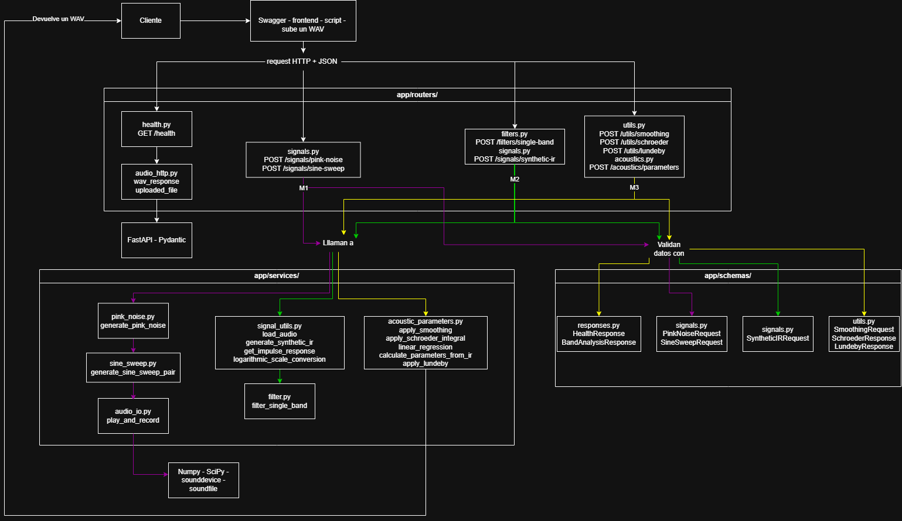

### Branching Strategy

La rama `main` está protegida, toda rama deberá ser integrada a través de un **Pull Request (PR)**

Para cada issue se creará una rama cuyo nombre será `feature/nombre-descriptivo`.

Los commits deberán seguir la nomenclatura `<tipo>: <descripción breve>`, los tipos pueden ser:
- `feat` :	Nueva funcionalidad
- `fix`:	Corrección de bug
- `docs`:	Cambios en documentación
- `test`:	Agregar o modificar tests
- `refactor`:	Reestructurar sin cambiar funcionalidad
- `style`:	Formato, espacios, puntos y comas

Para cada entrega se seguirá el siguiente flujo:
1. Asignación de issues correspondientes al Milestone actual
2. Cada desarrollador crea su rama
3. Desarrolla, hace commits y sube la rama al remote repo (GitHub)
4. Abre un Pull Request hacia `main`
5. Una vez que el PR pasa la revisión, se mergea
6. Al completar un Milestone, se etiquetará el commit en `main` con la versión correspondiente (`v0.1.0` para M1, `v0.2.0` para M2, `v1.0.0` para M3)

## Milestones y entregas (2C 2026)

| Milestone | Entrega | Tag | Evaluacion |
|-----------|---------|-----|------------|
| **M0 · El plano** (arquitectura) | mie 7/10 (asincronica, por Slack/GitHub) | — | Seguimiento, sin nota |
| **M1 · Generacion de senales** | mie 28/10 (en clase) | `v0.1.0` | Seguimiento, sin nota |
| **M2 · Procesamiento de la RI** | mie 4/11 | `v0.2.0` | Seguimiento, sin nota |
| **M3 · Producto final** + presentacion oral | mie 18/11 | `v1.0.0` | **Nota del TP: 60 % M3 + 40 % oral** |

- No hay informe escrito: la validacion de resultados va en una seccion **"Validacion"** de
  este README.
- **`AI_LOG.md`** en la raiz del repositorio es **obligatorio** (sin nota propia, pero sin
  `AI_LOG.md` M3 no se considera completo): registren el uso de herramientas de IA durante
  todo el proyecto.
- Detalle de cada milestone: <https://maxiyommi.github.io/signal-systems/trabajo_practico/ruta/>

### M0 · El plano

- [ ] Repositorio del grupo creado a partir del template, con los docentes como colaboradores.
- [ ] `uv sync`, `uv run uvicorn app.main:app --reload` y `uv run pytest` funcionan.
- [ ] README con integrantes y roles, instalacion, estructura y branching strategy.
- [ ] Diagrama de arquitectura (Mermaid o draw.io) con todos los modulos de M1, M2 y M3.
- [ ] Al menos 10 issues con labels (`milestone-1`, `milestone-2`, `milestone-3`) y asignados.

### M1 · Generacion de senales (`v0.1.0`)

- [ ] `generate_pink_noise()` en `app/services/pink_noise.py` (Voss-McCartney recomendado).
- [ ] `generate_sine_sweep_pair()` (sweep + filtro inverso) en `app/services/sine_sweep.py`.
- [ ] `play_and_record()` en `app/services/audio_io.py`.
- [ ] Endpoints `POST /api/v1/signals/pink-noise` y `POST /api/v1/signals/sine-sweep` (devuelven WAV),
      con sus schemas en `app/schemas/signals.py`.
- [ ] Tests de `tests/test_generacion.py` y los de M1 en `tests/test_api.py` pasando;
      graficas de validacion en `docs/m1/`.

### M2 · Procesamiento de la RI (`v0.2.0`)

- [ ] `load_audio()`, `generate_synthetic_ir()`, `get_impulse_response()` y
      `logarithmic_scale_conversion()` en `app/services/signal_utils.py`.
- [ ] `filter_single_band()` en `app/services/filter.py`.
- [ ] Endpoints `POST /api/v1/signals/synthetic-ir` y `POST /api/v1/filters/single-band`
      (recibe un WAV subido).
- [ ] Tests de `tests/test_procesamiento.py` y los de M2 en `tests/test_api.py` pasando.

### M3 · Producto final (`v1.0.0`)

- [ ] `apply_smoothing()`, `apply_schroeder_integral()`, `linear_regression()` y
      `calculate_parameters_from_ir()` en `app/services/acoustic_parameters.py`.
- [ ] Endpoints `POST /api/v1/acoustics/parameters`, `POST /api/v1/utils/schroeder` y
      `POST /api/v1/utils/smoothing`: la API completa.
- [ ] Tests de `tests/test_analisis.py` y todos los de `tests/test_api.py` pasando.
- [ ] Seccion "Validacion" en este README, `AI_LOG.md` y presentacion oral.
- [ ] (Opcional) `apply_lundeby()`.

## Tests

Las funciones de `app/services/` vienen como *stubs* que lanzan `NotImplementedError`. Sus
tests estan marcados como `xfail` (fallo esperado), asi el CI queda en verde desde el
primer dia:

- Mientras la funcion no este implementada, el test aparece como `x` (xfailed).
- Cuando la implementen bien, aparece como `X` (xpassed). En ese momento conviene **borrar
  la marca `xfail`** del modulo de tests (`pytestmark = ...`) para que el test cuente como
  un test normal. En `tests/test_api.py` la marca va test por test (`@xfail_m1`,
  `@xfail_m2`, `@xfail_m3`): borren la de cada endpoint que implementen.
- Si la implementacion es incorrecta, el test **falla** (rojo) con el `AssertionError`.

```bash
uv run pytest                                  # todos los tests
uv run pytest -v tests/test_generacion.py      # un archivo, con detalle
uv run pytest -v -k pink_noise                 # tests cuyo nombre contiene "pink_noise"
uv run pytest -rxX                             # listar xfailed / xpassed
uv run pytest --cov=app                        # con cobertura
```

`play_and_record` se testea con un *mock* de `sounddevice`, por lo que el CI no necesita
placa de audio. Para probarla de verdad, corran la funcion localmente con un parlante y un
microfono y documenten la configuracion (dispositivo, canales, fs, buffer size).

## Linter y formato

```bash
uv run ruff check app/ tests/          # verificar estilo
uv run ruff check --fix app/ tests/    # corregir lo automatico
uv run ruff format app/ tests/         # formatear
```

El CI (`.github/workflows/ci.yml`) corre `ruff check`, `ruff format --check` y
`pytest --cov=app` en cada push a `main` y en cada pull request.

## Configuracion

`app/settings.py` define la configuracion con `pydantic-settings`. Cualquier valor se puede
sobreescribir con variables de entorno con prefijo `RIR_` (por ejemplo `RIR_FS_DEFAULT=44100`)
o con un archivo `.env` en la raiz (ignorado por git).

## Referencias

- ISO 3382-1:2009 — Acoustics — Measurement of room acoustic parameters.
- Farina, A. (2000). *Simultaneous measurement of impulse response and distortion with a
  swept-sine technique.* 108th AES Convention.
- Schroeder, M. R. (1965). *New method of measuring reverberation time.* JASA 37(3).
- [FastAPI](https://fastapi.tiangolo.com/) · [Pydantic](https://docs.pydantic.dev/) ·
  [uv](https://docs.astral.sh/uv/)

## Evidencias de Validación - Milestone 1

### Espectrograma del Sine Sweep
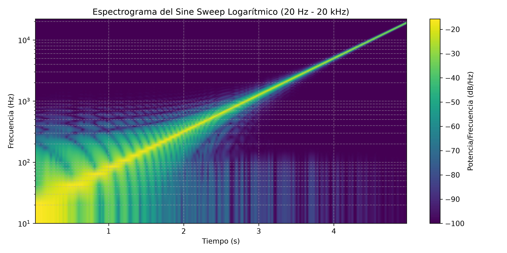

### Convolución Sweep * Filtro Inverso (Respuesta al Impulso)
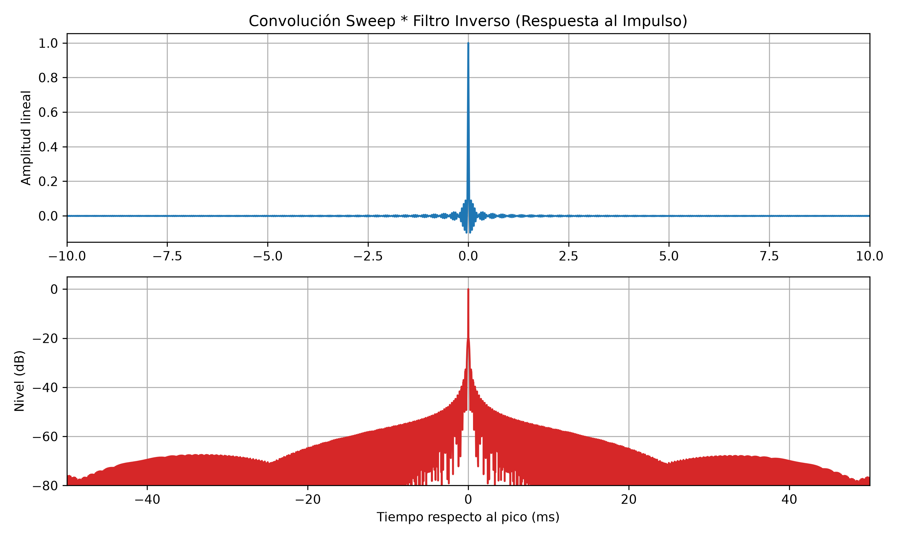

### Prueba de Reproducción y Grabación Simultánea
Se utilizó una placa de audio U_PHORIA UMC202HD en un canal mono grabada con un microfono Behringer Ultravoice XM8500 a una taza de muestreo de 44100 Hz y un Buffer Size de 256 Samples.
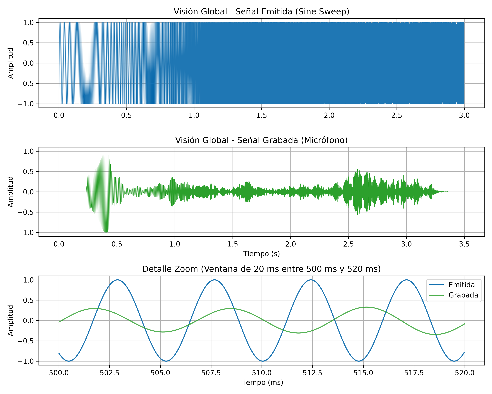

### Espectro del Ruido Rosa (-3 dB/octava)
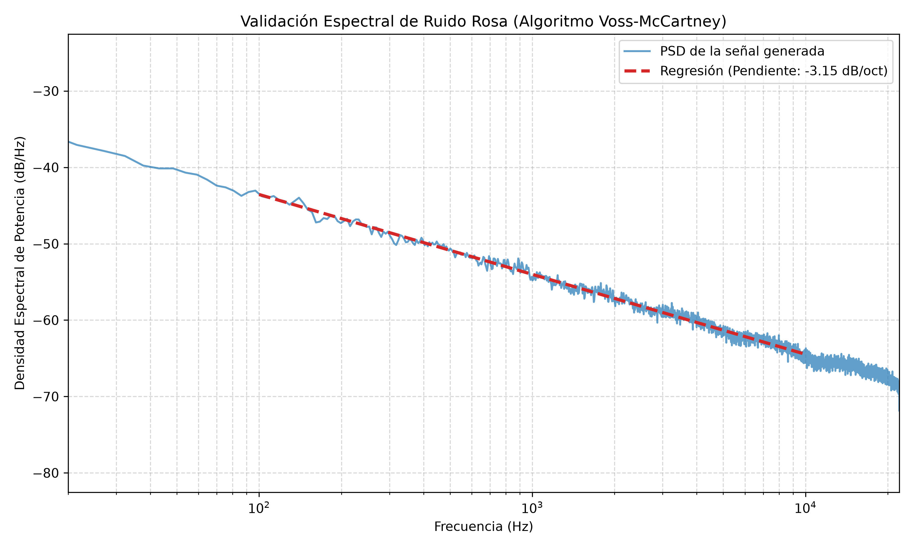

## Evidencias de Validación - Milestone 2

### Endpoints Integrados
- `POST /api/v1/filters/single-band`: Filtrado pasabanda por octava mediante filtros SOS IIR.
- `POST /api/v1/signals/synthetic-ir`: Generación de Respuesta al Impulso sintética parametrizada por $T_{60}$.

### Métricas de Calidad y Cobertura
- **Cobertura de Tests (`pytest`):** **93%** en `app/services` (exigido $\ge 80\%$).
- **Formato y Linteo (`ruff`):** 0 errores / 0 advertencias (`All checks passed!`).
- **Correlación de Pearson ($r$):** **$r = 0.9999$** en deconvolución sintética (exigido $r > 0.9$).

---

### Evidencias visuales (`docs/m2/`)
Se utilizaron dos archivos de respuestas al impulso reales extraidos de la pagina MIT IR Survey (https://mcdermottlab.mit.edu/Reverb/IR_Survey.html)
#### 1. Deconvolución de RI Sintética
Superposición temporal entre la RI sintética original y la recuperada tras convolución con *sine sweep* y filtrado inverso (alineación compensada por correlación cruzada):

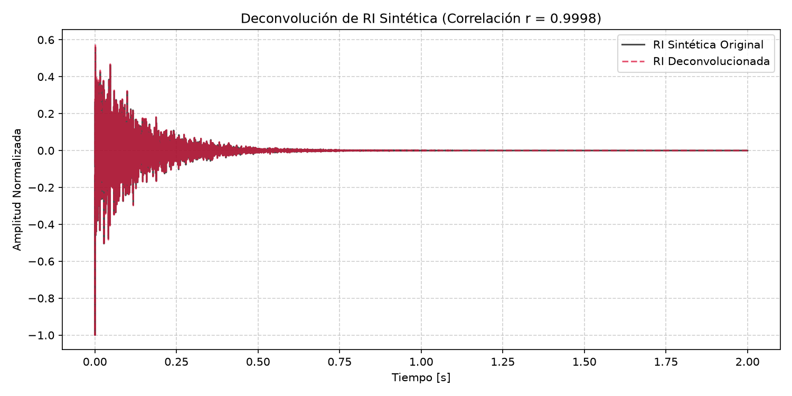

#### 2. Procesamiento de RI Real (T60 Corto)
Forma de onda, respuesta en frecuencia e iluminación de la banda pasante en 1 kHz, y curva de decaimiento en dB para un recinto de reverberación corta:

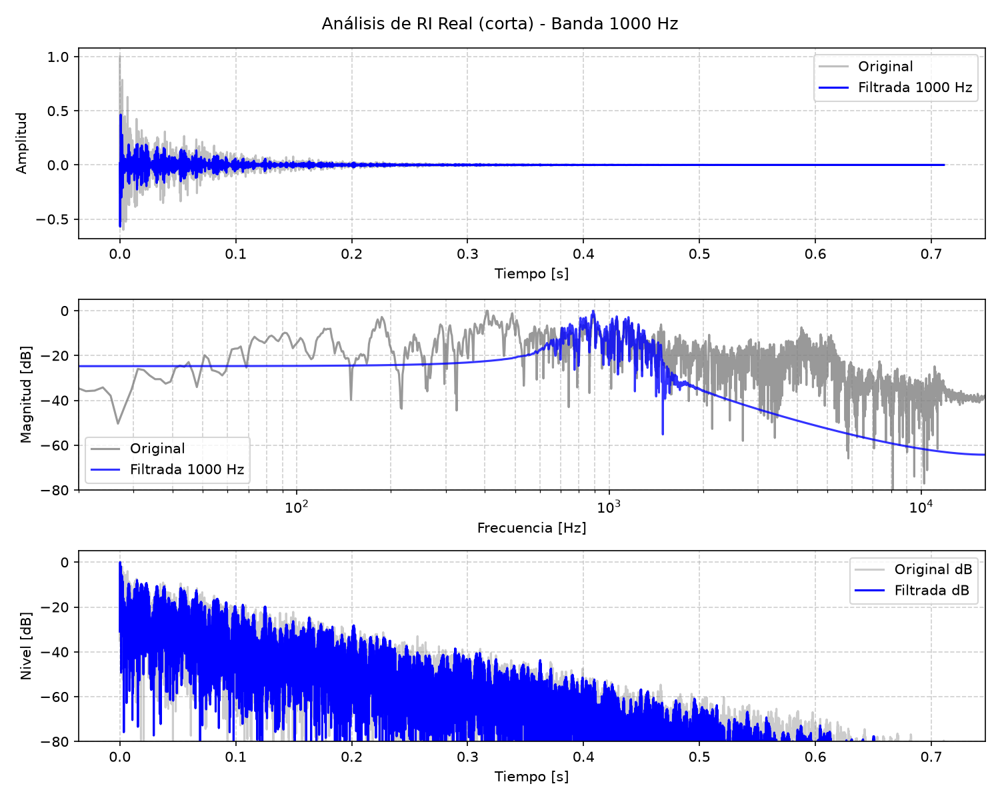

#### 3. Procesamiento de RI Real (T60 Largo)
Forma de onda, respuesta en frecuencia e iluminación de la banda pasante en 1 kHz, y curva de decaimiento en dB para un recinto de reverberación larga:

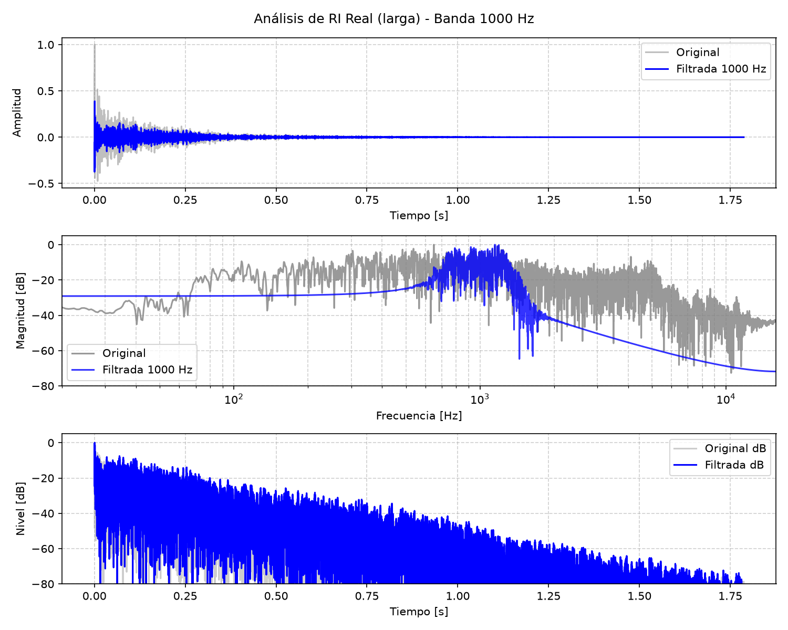

## Evidencias de Validación - Milestone 3

Para validar el cálculo de parámetros acústicos según **ISO 3382-1**, se contrastaron los resultados de **RIR-API** frente al software de referencia **REW (Room EQ Wizard v5.40)** y frente a la **API de referencia de la cátedra** en las bandas de octava de 125 Hz a 4000 Hz, utilizando una respuesta al impulso sintética ($T_{60\text{ nominal}} = 1.50\text{ s}$, $f_s = 48\text{ kHz}$) y una respuesta al impulso real (`ri_larga.wav`, $f_s = 32\text{ kHz}$).

### Criterios de aceptación
* **Tiempos de reverberación (`EDT`, `T20`, `T30`):** desviación máxima permitida de **$\pm 10\%$** (o $\pm 0.5\text{ s}$) respecto de la referencia.
* **Claridad musical (`C80`):** desviación máxima permitida de **$\pm 1.0\text{ dB}$** respecto de la referencia.

### 1. Tablas comparativas — RI Real (`ri_larga.wav`)

#### Early Decay Time (`EDT`)

| Banda (Hz) | RIR-API | Software Ref. (REW) | Diferencia | Dentro de tolerancia |
| :---: | :---: | :---: | :---: | :---: |
| 125 | 1.224 s | 1.140 s | +0.084 s (+7.4%) | Sí ($\le 10\%$) |
| 250 | 1.471 s | 1.496 s | -0.025 s (-1.7%) | Sí ($\le 10\%$) |
| 500 | 1.540 s | 1.602 s | -0.062 s (-3.9%) | Sí ($\le 10\%$) |
| 1000 | 1.510 s | 1.516 s | -0.006 s (-0.4%) | Sí ($\le 10\%$) |
| 2000 | 1.124 s | 1.135 s | -0.011 s (-1.0%) | Sí ($\le 10\%$) |
| 4000 | 0.528 s | 0.535 s | -0.007 s (-1.3%) | Sí ($\le 10\%$) |

#### Tiempo de Reverberación (`T20`)

| Banda (Hz) | RIR-API | Software Ref. (REW) | Diferencia | Dentro de tolerancia |
| :---: | :---: | :---: | :---: | :---: |
| 125 | 1.535 s | 1.428 s | +0.107 s (+7.5%) | Sí ($\le 10\%$) |
| 250 | 1.533 s | 1.519 s | +0.014 s (+0.9%) | Sí ($\le 10\%$) |
| 500 | 1.762 s | 1.714 s | +0.048 s (+2.8%) | Sí ($\le 10\%$) |
| 1000 | 1.584 s | 1.581 s | +0.003 s (+0.2%) | Sí ($\le 10\%$) |
| 2000 | 1.123 s | 1.177 s | -0.054 s (-4.6%) | Sí ($\le 10\%$) |
| 4000 | 0.599 s | 0.638 s | -0.039 s (-6.1%) | Sí ($\le 10\%$) |

#### Tiempo de Reverberación (`T30`)

| Banda (Hz) | RIR-API | Software Ref. (REW) | Diferencia | Dentro de tolerancia |
| :---: | :---: | :---: | :---: | :---: |
| 125 | 1.591 s | 1.549 s | +0.042 s (+2.7%) | Sí ($\le 10\%$) |
| 250 | 1.594 s | 1.605 s | -0.011 s (-0.7%) | Sí ($\le 10\%$) |
| 500 | 1.787 s | 1.766 s | +0.021 s (+1.2%) | Sí ($\le 10\%$) |
| 1000 | 1.631 s | 1.633 s | -0.002 s (-0.1%) | Sí ($\le 10\%$) |
| 2000 | 1.224 s | 1.308 s | -0.084 s (-6.4%) | Sí ($\le 10\%$) |
| 4000 | 0.658 s | 0.710 s | -0.052 s (-7.3%) | Sí ($\le 10\%$) |

#### Claridad Musical (`C80`)

| Banda (Hz) | RIR-API | Software Ref. (REW) | Diferencia | Dentro de tolerancia |
| :---: | :---: | :---: | :---: | :---: |
| 125 | 2.72 dB | 2.36 dB | +0.36 dB | Sí ($\le 1\text{ dB}$) |
| 250 | 1.61 dB | 1.19 dB | +0.42 dB | Sí ($\le 1\text{ dB}$) |
| 500 | -0.25 dB | -0.20 dB | -0.05 dB | Sí ($\le 1\text{ dB}$) |
| 1000 | 0.13 dB | 0.34 dB | -0.21 dB | Sí ($\le 1\text{ dB}$) |
| 2000 | 2.69 dB | 2.81 dB | -0.12 dB | Sí ($\le 1\text{ dB}$) |
| 4000 | 9.03 dB | 9.44 dB | -0.41 dB | Sí ($\le 1\text{ dB}$) |

---

### 2. Tablas comparativas — RI Sintética ($T_{60\text{ nominal}} = 1.50\text{ s}$)

#### Tiempo de Reverberación (`T20`)

| Banda (Hz) | RIR-API | Software Ref. (REW) | Diferencia | Dentro de tolerancia |
| :---: | :---: | :---: | :---: | :---: |
| 125 | 1.693 s | 1.651 s | +0.042 s (+2.5%) | Sí ($\le 10\%$) |
| 250 | 1.589 s | 1.594 s | -0.005 s (-0.3%) | Sí ($\le 10\%$) |
| 500 | 1.425 s | 1.440 s | -0.015 s (-1.0%) | Sí ($\le 10\%$) |
| 1000 | 1.471 s | 1.483 s | -0.012 s (-0.8%) | Sí ($\le 10\%$) |
| 2000 | 1.542 s | 1.526 s | +0.016 s (+1.0%) | Sí ($\le 10\%$) |
| 4000 | 1.496 s | 1.492 s | +0.004 s (+0.3%) | Sí ($\le 10\%$) |

#### Tiempo de Reverberación (`T30`)

| Banda (Hz) | RIR-API | Software Ref. (REW) | Diferencia | Dentro de tolerancia |
| :---: | :---: | :---: | :---: | :---: |
| 125 | 1.566 s | 1.615 s | -0.049 s (-3.0%) | Sí ($\le 10\%$) |
| 250 | 1.501 s | 1.505 s | -0.004 s (-0.3%) | Sí ($\le 10\%$) |
| 500 | 1.476 s | 1.472 s | +0.004 s (+0.3%) | Sí ($\le 10\%$) |
| 1000 | 1.485 s | 1.485 s | 0.000 s (0.0%) | Sí ($\le 10\%$) |
| 2000 | 1.524 s | 1.515 s | +0.009 s (+0.6%) | Sí ($\le 10\%$) |
| 4000 | 1.513 s | 1.512 s | +0.001 s (+0.1%) | Sí ($\le 10\%$) |

### Gráficas de validación y pipeline DSP

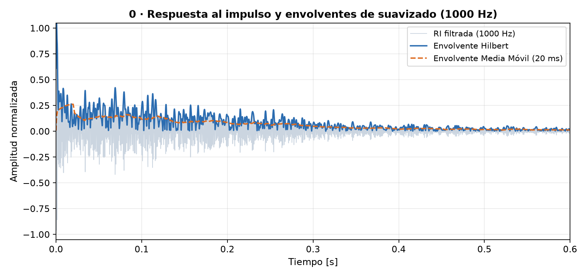
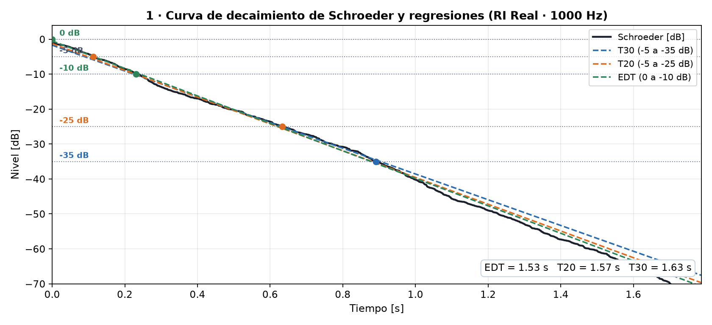
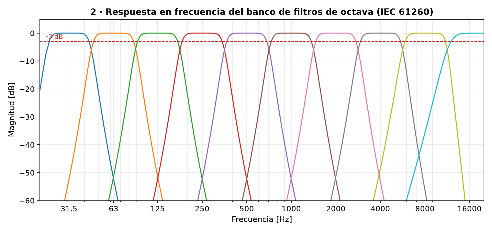
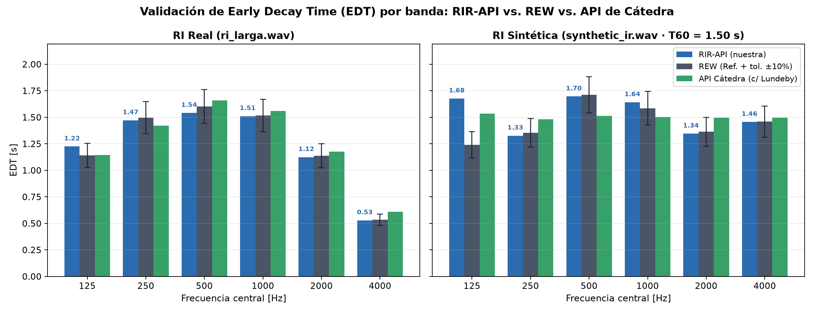
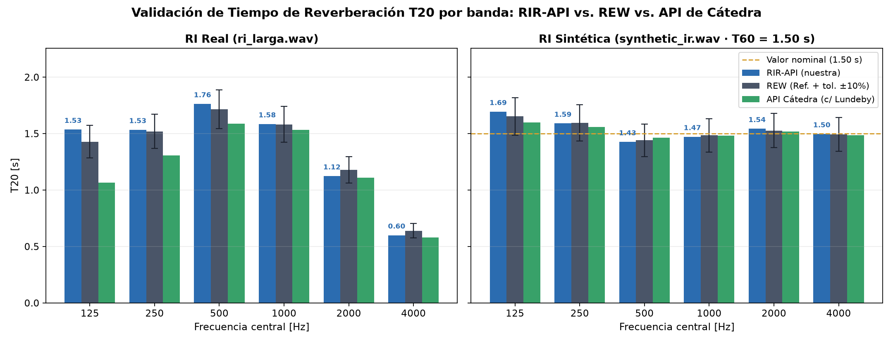
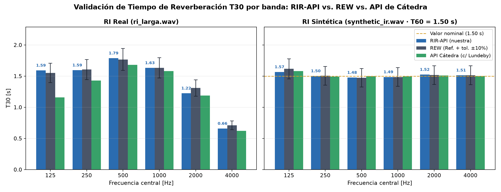
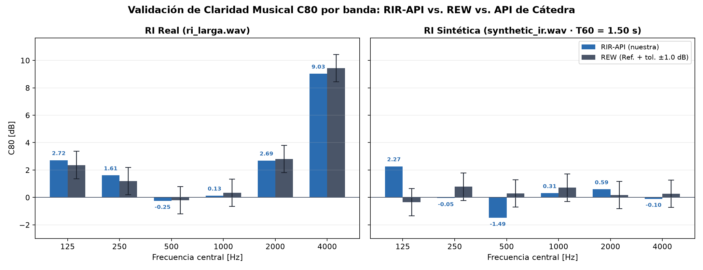
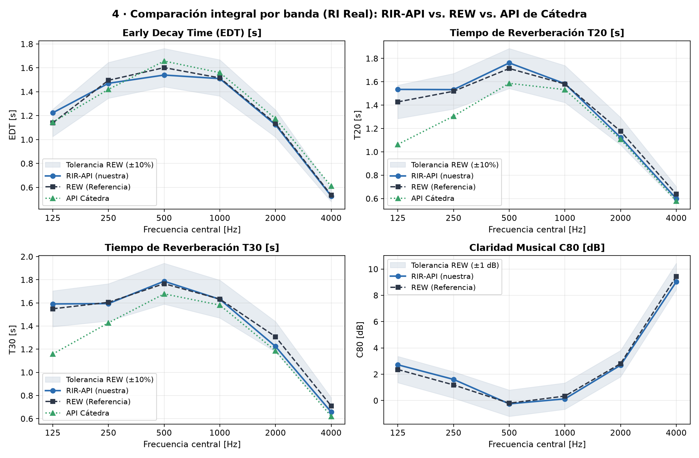
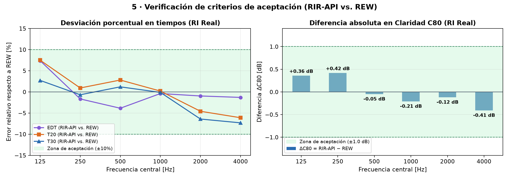